# Mars Rancher: Chicken Fighters — Glass Box Dev Log

*2026 Epic AI MegaJam · UEFN track · team IRONICS*

Mars Rancher: Chicken Fighters is a Fortnite (UEFN) island where you run a ranch on Mars, raise crops and Moon Cows for Mars Credits (MC), and send armoured chickens into hay-bale rings for broadcast-style fights called by two chicken announcers. It was built by one developer working with a team of Claude Code agents. Each agent had a role (coordinator, combat, economy, UI, collection, world builder, World Sets, booth, FX) and drove Blender and the UEFN editor itself through the editor's built-in MCP server. This page tells that story from the raw session log: what we tried, what worked, and what didn't.

---

## Nov 11: before the jam

Everything made before the jam opened (Wed Nov 11, 9 PM PT) was declared up front: the design handoff, the economy spec, and ten of the developer's own 2D concept sheets. They included the base chicken turnaround, the Moon Cow, two farm packs and two sheets of "Light World" and "Dark World" chickens that come back on day three. Also declared: a research brief, and generic tooling (agent skills, MCP configs and editor helper scripts) carried over with only the paths changed. All of it went into a provenance file with file hashes before any jam work started.

## Nov 12: bake-off, first fight, a lot of systems

**The bake-off.** The plan was to generate the base Chicken Fighter in Meshy, Hyper3D Rodin and Tripo, score each one and pick a winner. It ended up much smaller. The developer dropped Meshy before it started, and Tripo's API wasn't usable that night, so only **Rodin** ran. Its Gen-2.5-High model, made from four views of a clean T-pose sheet, matched the concept closely (goggles, comb, bandana, harness, chest core, talons, tail) at 20,000 triangles and one material. The bake-off didn't find the best tool. It found the one that worked that night. Rodin went on to make every character and the custom environment pieces.

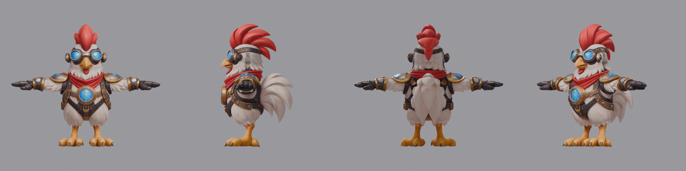
*The bake-off model: Rodin Gen-2.5-High from a four-view T-pose sheet.*

**Rigging, attempt one.** Rodin's auto-rig gave the chicken a 52-bone human skeleton and 10 stock clips. A Blender agent turned those into 13 game clips and passed rig QA. Getting the chicken into UEFN took two more fixes. The MCP's one-call import ignored FBX units and produced a 1.2 cm chicken. Then the first fight ran perfectly in the log, but no chicken showed up on screen: a baked ×100 scale on the Hips bone had put the body about 36 cm underground. After the clips were re-imported at scale 100, both chickens fought a full AI match in session at 21:10 PT: 13 beats, 54 seconds, a REWIND and a KO. The announcers (Skip and Boom), the Moon Cow (23 bones) and the Moon Worm (a 9-bone chain plus jaw) were rigged by hand in Blender with no credits spent. The announcers share the chicken skeleton and all 13 of its clips.

**The line bank.** A subagent drafted 300 booth lines for Skip (play-by-play) and Boom (analyst), including 56 call-and-response pairs. The rules: teen-safe, a KO is a "power-down with sparks" and never an injury, no real people, brands or catchphrases, and every line at most 84 characters so it fits a phone caption. Three lines were cut in edit: a turkey-stuffing joke, a barbecue joke, and one that echoed a real sportscaster's catchphrase. The developer approved the rest. A generator turns the CSV into Verse data, and the booth plays it from shuffle bags with no repeats per session, a per-speaker cooldown and a priority order of KO, then REWIND, then Big Finish. The developer renamed the moves to PECK, BLOCK, TALON KICK and REWIND, so 33 lines were updated in their player-facing text.

**Systems in parallel.** By the end of the night we also had an economy simulator, a HUD redesign built from concept art the developer approved, an AI ladder that reads the player's habits so spamming PECK stops paying off, boards, persistence, and a three-ring Challenge Arena. The developer made two scope calls that shaped the game. Farming and fighting became **separate loops**. Winning a challenge earns a **Rival Plaque** (a trophy of the chicken you beat), and no chicken ever changes hands.

**The first crash.** At 21:38 PT the editor crashed with a graphics-driver error while a session was starting. When it came back it opened a stale copy of the project from an old default folder, and two "clean" builds turned out to have compiled that copy. Editor work stopped until the real project was opened by its path and checked (786 actors, against 433 in the stale copy).

## Nov 13: contact, the worm, homesteads, the first test version

**Making fights touch.** The developer's note: the chickens stood about 5 m apart and played their clips in place. A probe showed that **pushing NPCs from Verse doesn't work**. What worked: marks 1.5 m apart, hit reactions timed to the impact, and forward lunges baked into new Blender clips (peck lunge 0.73 m, jump kick 0.95 m), again with no credits spent.

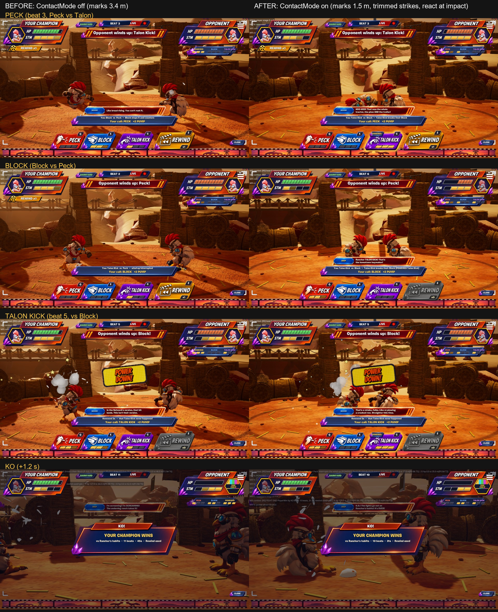
*Left: the original fight at 3.4 m spacing. Right: ContactMode with 1.5 m marks, trimmed strikes and reactions on impact.*

**The Moon Worm.** The boss uses the same combat engine with its own moves (Jaw Snap, Dust Roar, Quake Slam), a title plate and booth lines. Getting it on camera took several passes. Its mound blocked every teleport, the developer spotted that the worm "has no tail, cut flat like a statue base", and the cave slab didn't move.

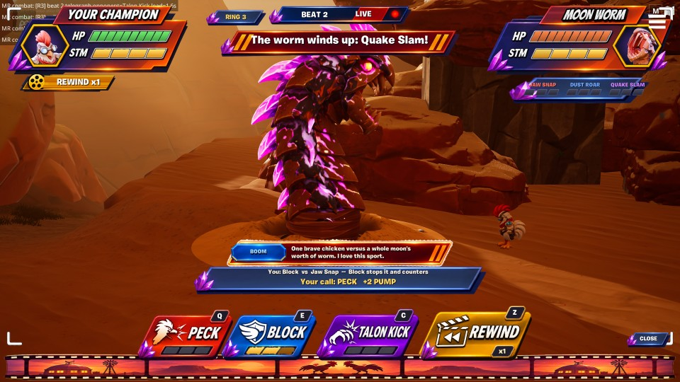
*The Moon Worm in session, with its own move names, title plate, portrait and booth line.*

**The economy and ranch loop.** You plant and harvest crops, run them through the Feed Mill, sell at the Trade Post, fill Colony orders, and raise Moon Cows for milk and sale value. Fights pay purses on top. A Python simulator mirrored the Verse rules all week. It set cow upkeep at 175 MC per cow per day on Nov 12 (later 100) and flagged balance gaps between the ways to play. The developer asked for player-built farms, which became **homesteads**: 16 parcels with 6 build pads each. Builds spawn as Scene Graph entities, because a spike test showed the prop-spawning route rejected our own props. Twelve build models were generated (6 in Rodin, 6 in Tripo's web app) and cut down to game budgets in Blender.

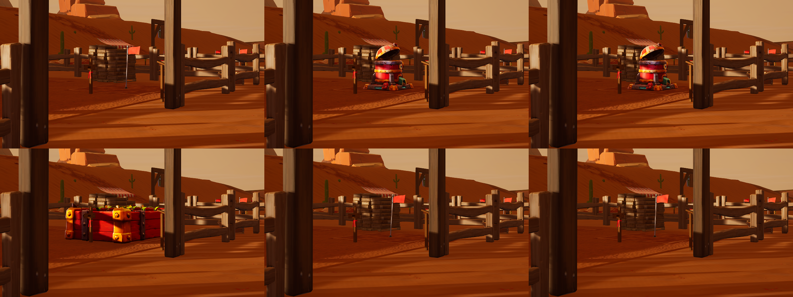
*A build pad in session: empty pad with its stake flag, a Compost Bin, a Garden upgrade that replaces it, and demolish bringing the stake back.*

**First test version.** Late on Nov 13 morning, the developer uploaded the first private test version. On PC the hidden BUILD button, building a compost bin and persistence across a relog all passed. The test also found a real bug. Market days are 15-minute UTC windows, and at the first rollover dome upkeep took a new player's last 20 MC. With 0 MC they couldn't buy seeds or pay a fight fee. The fix: a free first day for new ranches, a 20 MC floor that upkeep never takes, and a visible "Dome upkeep" notice. A phone account couldn't open the private version, so mobile testing was deferred.

**Chicken collection.** The developer asked where the "extensive collection" had gone; at that point there were 4 skins. The collection agent built 24 colourway breeds with earn rules, portraits and a Coop Collection gallery. The first plan for getting breeds into the ring was a registry device holding one NPC Character Definition per breed. The developer tested the editor picker, and it doesn't offer those assets, so that route was dead. The combat agent replaced it with a **breed-spawner pool**: one spawner per breed, parked and reused between fights.

## Nov 13 night – Nov 14 morning: World Sets, exits, the test sprint

**World Sets.** The developer's Light and Dark World sheets became 20 unique 3D breeds in 10 twin pairs (Lumen 24–33, Umbral 34–43). A Dark breed unlocks only after you own its Light twin, and owning both earns a set title. The developer's calls: keep the art as drawn, do all 20 this jam, and start with a pilot pair, **Lumen Crystal and Umbral Crystal**.

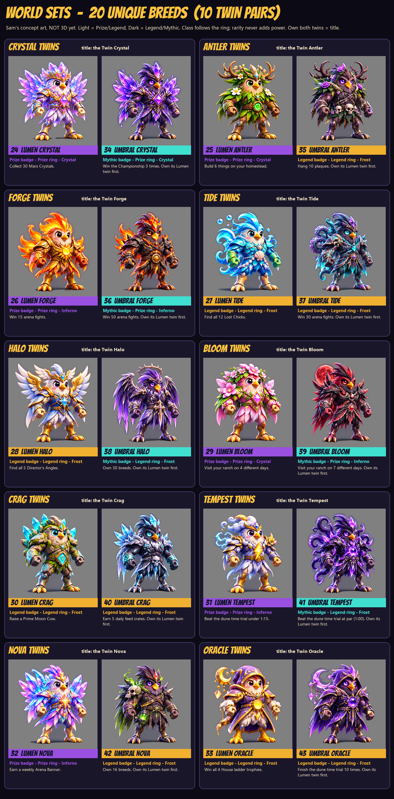
*the developer's World Set designs as planned: rarity, ring, class and earn goal for each twin.*

**Rigging, attempt two (failed).** The pilot meshes from Rodin were faithful, but rigging them on the shared chicken skeleton failed. Its arm chain is about 40% longer than these chibi arms, so in a kick the transferred hand weights landed on the legs. Edges stretched 0.76–1.06 m, against 0.09–0.13 m on the base chicken.

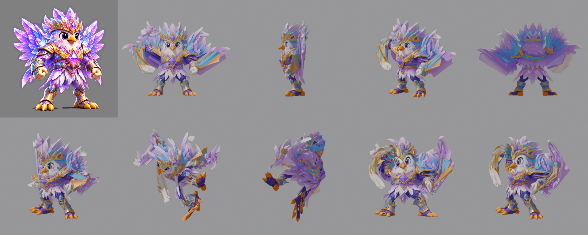
*The failed pilot: the bind pose is clean, but the kick and finish poses tear.*

**Rigging, attempt three: route C.** Rodin's own auto-rig uses the same 52 bone names and hierarchy as our skeleton. Route C keeps Rodin's weights and the concept's proportions, turns each bone to the base rest direction and bakes it, then fits the chicken to 1.20 m tall. Hips use scaled animation retargeting and the other 51 bones use skeleton mode. An audit showed only the Hips bone carries translation in all 18 chicken clips, so skeleton mode changes nothing for the 24 breeds already shipped, and a session confirmed it. The World chickens need no per-breed clips and no Verse changes.

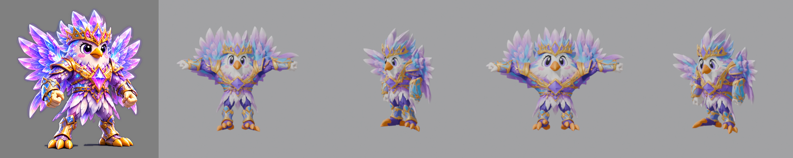
*Concept crop, then route C (the concept's proportions), then route A (legs squashed to base lengths). Route C shipped.*

A batch script rigged the other 18. Capes and wrist-to-hip ribbons that tore were fixed by smoothing their weights. One tentacle strip was deleted, a floating moon became a halo disc, and three textures that Rodin's de-lighting had washed out were graded back toward the concept colours.

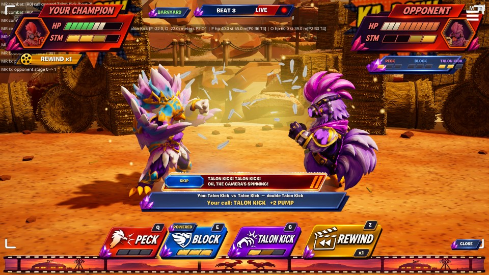
*A World chicken in the ring: Lumen Crystal (left) trades talon kicks with a colourway Crystal.*

**The T-pose portraits.** The first World Set card portraits had two problems. They were rendered from the old failed mesh, and then the bodies came out in a T-pose. The pose files had been exported without the mesh, so Blender read the fight pose as the rest pose. Exporting the pose with the mesh fixed it, and all 20 were re-rendered and reviewed.

*The bug: pilot busts in the T-pose instead of the fight pose, next to a shipped breed's bust (left) for reference.*

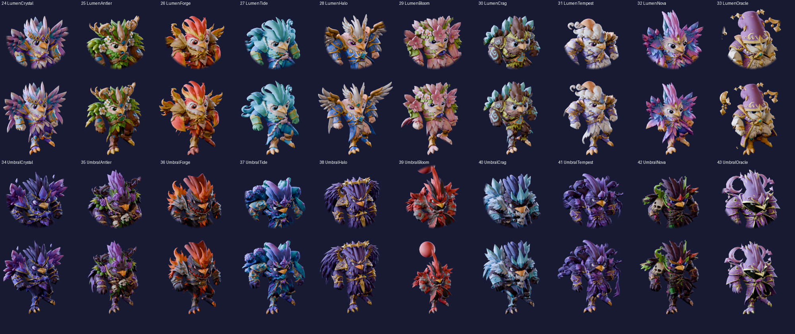
*After the fix: all 20 World Set busts and full-body portraits in fight pose.*

**The one-wave ship flip.** World Sets were built behind a hidden wave 3. Shipping them took one data change: waves 24–43 went from 3 to 2, and the spawner pool went from 23 breeds to 43, with rollback files saved first. The first ship session was wasted because two arguments were passed in the wrong order. The next morning the gallery was proven: 44 breeds, a WORLD SETS tab and "NEEDS TWIN" cards. In the test sprint Lumen Crystal and its Umbral twin were hatched and the "TWIN SET COMPLETE" state showed.

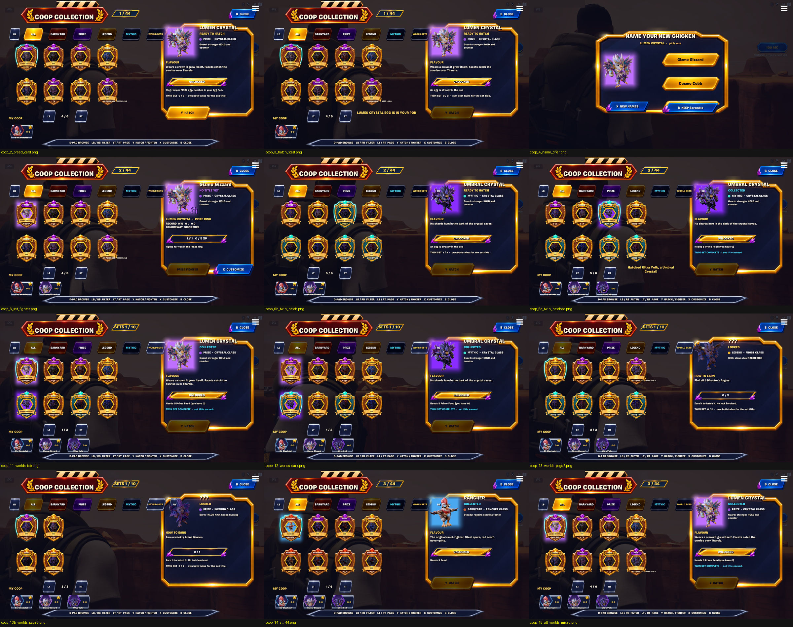
*Test sprint: Lumen Crystal ready to hatch, name offer, Umbral Crystal hatched, TWIN SET complete, SETS 1 / 10.*

**The exit redesign.** Between fights, chickens used to leave in a recall beam. The developer's review: "loud noise, horrible animations, walk off camera into the wall, weird sparkle disappear." We removed the beams and their sound. The world builder added six corner gates (stock fence leaves between bale jambs). Now the loser limps out and the winner struts out through its own gate, the gate swings shut, and the new chickens walk in from behind theirs. If a walk fails or times out, a HUD **exit wipe** covers the screen and the rest finishes under it. One bug had the red chicken walking into the bale wall: its gate offset and the side spread both ran along X, so it aimed at a barrel behind the wall. The camera went through three versions, ending on a victory pose in front of the shut gate that cuts straight to the next arrival.

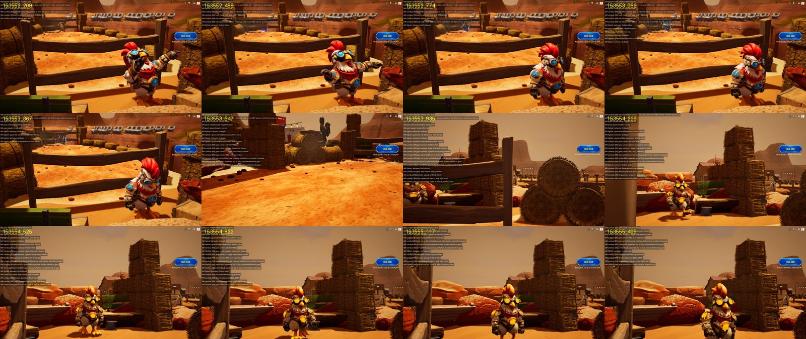
*The final exit: the winner poses outside its gate, then the camera cuts to the newcomer walking in.*

Two problems were still open on Saturday morning: about 0.5 s of camera blend before each arrival close-up, and a spawn sparkle on one World breed. The plan is to hide the blend under the HUD wipe.

**Voices.** The voiced booth lines were made with Kokoro-82M from original blended voice designs, with no cloning and no recording of any real person. Of 93 rendered lines, 85 passed a Whisper read-back and 8 stay caption-only. On Saturday morning the developer decided to ship the voices with captions always on, and to give live AI booth personas one test slot with a kill switch.

---

## What went wrong

- **A one-sided bake-off.** Tripo's API wasn't usable that night, so there was no real three-way comparison.
- **Import units.** A 1.2 cm chicken, then chickens 36 cm underground.
- **NPC lunges from Verse.** Velocity, impulse and teleport steps all failed, so the motion was baked into clips.
- **A terrain material broke NPC navigation.** Our Mars material on the ring ground pieces made `NavigateTo` and `TeleportTo` fail every beat. Putting two pieces back to stock fixed ring 0 (an A/B test). The plan for the other rings is to move the colour onto cover meshes that don't affect navigation.
- **Dead ends.** The breed registry (the editor picker doesn't offer NPC Character Definitions) and two World Set rig routes before route C.
- **Bad first World Set portraits.** They came from the wrong mesh and from T-pose pose files.
- **Editor crashes** (a graphics-driver error and an out-of-video-memory crash). One came after a session start had already saved debug values to disk, so every proof script now writes a restore journal first. The journal also recovered a slot after a laptop restart.
- **Stale project copies** in an old default folder, until that setting was repointed and the project was always opened by path.
- **Editor memory bloat.** About 20.7 GB committed on a 15.3 GB machine killed several proof runs.
- **Shared build breaks.** One FX file with 51 errors broke the build for everyone. Since then all changes are staged and copied in only after a clean build.
- **Validation blockers** from disallowed engine textures and stock lamp posts.
- **The 0 MC soft-lock** in the first playtest.
- **A capture of the wrong window** when the client wasn't in front. The frames were deleted, and the tool now captures only the client.
- **One wasted session** from arguments passed in the wrong order.

## How we worked

**Roles.** A coordinator agent ran the plan and the reviews. Specialist agents owned their own modules: combat, economy and persistence, UI, collection, world, World Sets, booth and FX, plus short-lived scoping and audit agents. The developer made the design calls, opened the project, and did the Lore check-ins and uploads.

**The MCP workflow.** Agents drove the UEFN editor through its built-in MCP server at `127.0.0.1:8000`: placing and wiring devices, importing assets, running editor Python, building Verse, starting play sessions and reading logs. Blender ran headless for rigs, clips, cleanup and renders.

**Lock slots.** Only one agent could hold the editor for a session at a time, controlled by a lock file. Most work was staged as files, then brought in during a short slot: copy, one build, one session, restore every debug flag, run a strict pre-upload audit and validation, then release the lock. When about 130 saves landed while another agent held the lock, we logged it and tightened the rule.

**Proof beats compile.** A clean build didn't make a feature done. It was done only once it had been played in a session and captured or logged.

**Provenance and credits.** Every asset, line bank and voice file has a provenance row with its tool, source, date and licence. Rodin made the characters and custom props, ChatGPT made the reference sheets and UI concepts, Tripo made six build props, Kokoro made the voices, and CC0 libraries supplied the sound effects. Agents spent no generation credits without the developer's OK, and most of the rigging, animation and texture work cost none.
